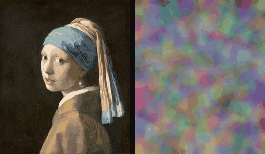
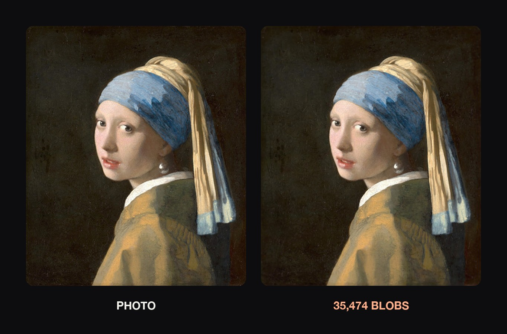
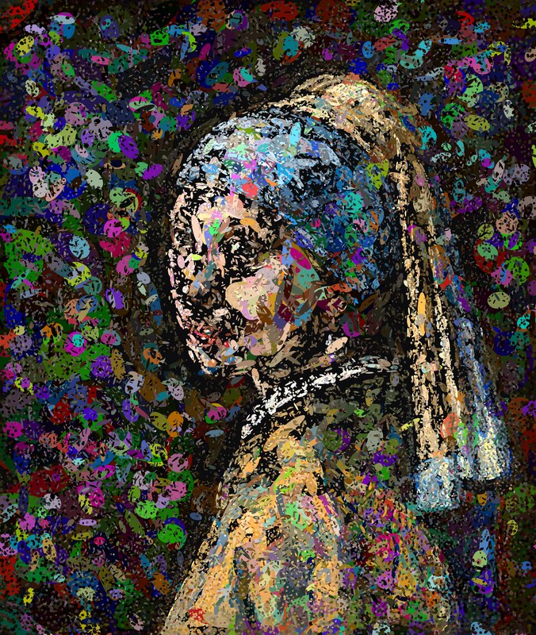
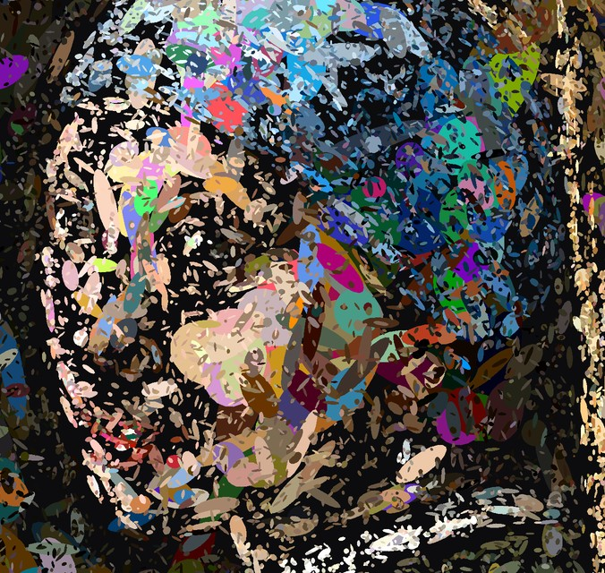
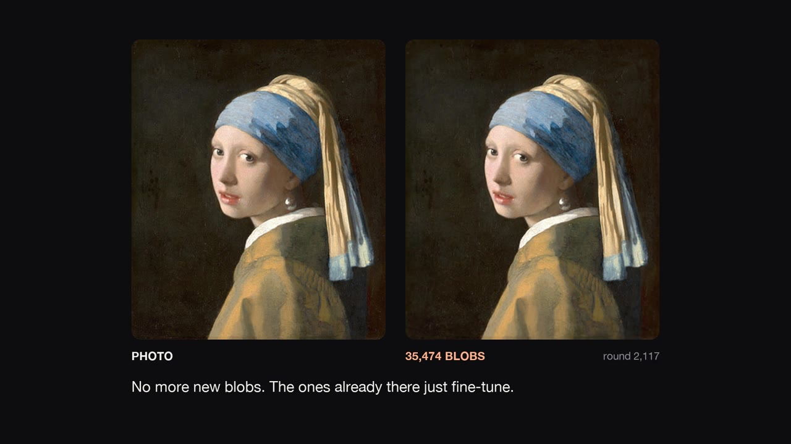

# blobsmith

**Give it any picture. It rebuilds that picture out of tens of thousands of soft blobs of colour, and records itself doing it.**

<p align="center">
  
</p>

One command turns a photo into a blob painting, a training GIF, a video, and a small web page where you can scrub through the whole run. There is no AI image model inside: only a painter that draws blobs, and a loop that keeps correcting them.

```bash
python -m blobsmith your-photo.jpg
```

## Quick start

You need Python 3.9 or newer. `ffmpeg` is optional and only used for the video.

```bash
git clone https://github.com/Mukundkapoor26/blobsmith.git
```

```bash
cd blobsmith
```

```bash
python3 -m venv .venv && .venv/bin/pip install -r requirements.txt
```

Try it on the included example (about a minute with `--quick`):

```bash
.venv/bin/python -m blobsmith examples/pearl-earring.jpg --quick
```

Then run it properly on your own picture:

```bash
.venv/bin/python -m blobsmith path/to/your-photo.jpg
```

The default run took just under 8 minutes on an Apple M1 laptop, on the CPU. On Windows, use `.venv\Scripts\python` in place of `.venv/bin/python`.

## What you get

Everything lands in `runs/<name of your photo>/`:

| File | What it is |
|---|---|
| `blobs.png` | The finished blob painting, same size as the working copy of your photo |
| `blobs_3x.png` | The same blobs painted three times larger |
| `side_by_side.png` | Original and blobs next to each other, labelled, ready to post |
| `discs.png` | Every blob drawn as a flat hard-edged shape, so you can see them |
| `training.gif` | The painting forming, next to the original |
| `film.mp4` | A 16-second 1080p video of the run with captions (needs `ffmpeg`) |
| `viewer/index.html` | A page that replays the run: target, blobs, error map, chart, scrub bar |
| `viewer/film.html` | A clean 16:9 side-by-side page, made for screen recording |
| `blobs.npz`, `meta.json`, `frames/` | The raw blobs, the run's numbers and the recorded frames |

The viewer pages open straight from disk. Double-click `viewer/index.html`; no server needed.

<p align="center">
  
</p>

On the example, the result is 35,474 blobs and differs from the original by 1.0 out of 255 per colour value on average (43.7 dB PSNR).

## The blobs are real

Switch the soft edges off and each blob shows up as its own shape. Big ones cover flat areas, tiny ones crowd around edges and highlights.

<p align="center">
  
  &nbsp;
  
</p>

## How it works

A blob is nine numbers: where it is (2), how wide and tall (2), which way it points (1), its colour (3) and how strong it is (1). A picture is just a long list of them.

The program repeats four moves:

1. **Paint.** Draw all the blobs into an image. Each pixel becomes the weighted average of the blobs that reach it.
2. **Compare.** Subtract the photo. Squash what is left into a single score.
3. **Correct.** Because the painter is ordinary differentiable maths, PyTorch can say which way to move each of the nine numbers on each blob to lower the score. Each one moves a small step that way.
4. **Again.** 2,400 times by default.

A few choices keep it fast and sharp:

- **Small copies before the real one.** The first rounds match a quarter-size copy of the photo, then a half-size one, then the real thing. Large shapes settle before detail is attempted.
- **Blobs are added where the picture is worst.** It starts with 1,500 random blobs. Every 40 rounds it looks at the error and drops small new blobs on the worst spots, up to the limit.
- **One patch per round.** At full size it works on a random 200-pixel patch each round and paints only the blobs that touch it.
- **Big blobs are painted coarsely.** A large soft blob has no fine detail, so it is drawn on a smaller grid and scaled up. That makes a blob cost about the same whatever its size.

<p align="center">
  
</p>

The technique has a name: fitting an image with 2D Gaussians, often called 2D Gaussian splatting. Its 3D cousin is what turns a handful of photos into a scene you can move around in.

## Options

| Flag | Default | What it does |
|---|---|---|
| `--size` | 400 | Longest side to work at, in pixels. Bigger is sharper and slower. |
| `--steps` | 2400 | Number of rounds |
| `--blobs` | 36000 | The most blobs it may use |
| `--start-blobs` | 1500 | Random blobs to begin with |
| `--crop` | 200 | Patch size for full-size rounds; 0 uses the whole picture |
| `--out` | `runs/<photo name>` | Where the results go |
| `--device` | `cpu` | `mps` or `cuda` also work, but the CPU was faster on the laptop this was built on |
| `--seed` | 0 | Change it for a different starting scatter |
| `--quick` | off | 200 rounds and 4,000 blobs, to check everything works |
| `--no-media` | off | Train only; skip the GIF, video and viewer |

To rebuild the pictures, GIF, video and viewer for a run you already have:

```bash
.venv/bin/python -m blobsmith.media runs/pearl-earring
```

## What's in the repo

| Path | What it is |
|---|---|
| `blobsmith/render.py` | The painter: blobs in, picture out, differentiable |
| `blobsmith/train.py` | The loop: Adam written out by hand, adding and pruning blobs, recording frames |
| `blobsmith/media.py` | Stills, GIF, video and the viewer data |
| `blobsmith/viewer/` | The two web pages, copied into every run |
| `examples/pearl-earring.jpg` | A public-domain picture to try it on |

## Honest limits

- It copies one picture. It cannot make up a new one, and it learns nothing it could reuse on another.
- It is not compression. 35,474 blobs is about 319,000 numbers, more than a JPEG of the same picture needs.
- Working size is small by default (400 pixels on the long side). Larger sizes work but take longer and want more blobs.
- Only tested on macOS with an Apple M1. The `cuda` path has not been tried.

## Credits

- The example picture is Johannes Vermeer's *Girl with a Pearl Earring* (c. 1665), public domain, from Wikimedia Commons.
- Blobs-as-Gaussians comes from the Gaussian splatting line of research, starting with Kerbl et al., *3D Gaussian Splatting for Real-Time Radiance Field Rendering* (2023).
- The spark for pointing it at a single portrait was Sirio Berati's [gradient-descent-for-a-face](https://github.com/sirioberati/gradient-descent-for-a-face). blobsmith is a separate implementation written from scratch and shares no code or assets with it.

## Licence

MIT. See [LICENSE](LICENSE).
